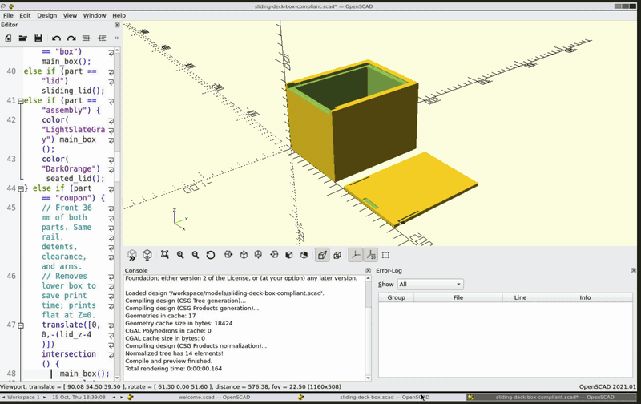

# agent-tool-openscad

OpenSCAD desktop and MCP tools in one Docker container. Agents create, render,
measure, and export models. People inspect the same files through noVNC.



## Ask your agent

Copy [AGENT_PROMPT.md](AGENT_PROMPT.md) and replace design placeholder.
Prompt covers local installation, Docker startup, MCP connection, design, checks, and exports.
No account, private network, or host CAD installation is required to run this tool.
GitHub and public package repositories need internet access during installation.

## Automatic local setup

Clone repository, enter directory, then run:

```sh
python3 scripts/setup.py
```

Keep at least 12 GiB free on host disk before building.
Python 3.10+ standard library is enough. On Windows, use `py -3` or `python` if needed.
Setup preserves other .env settings, checks loopback port availability, and runs smoke checks.
Default host port: **48321**. Occupied defaults use another available port, saved in .env.
To require a specific free port, use `python3 scripts/setup.py --port 49000`.
Environment variables override .env; clear any conflicting `CAD_PORT` override before later manual Compose commands.
Direct `docker compose up` uses configured port and reports conflicts; it does not select another port.
Container port stays 8080. Two repositories use different default host ports and independent named volumes.

## Agent connection

Service exposes Streamable HTTP MCP. Use setup's reported URL in your harness's documented MCP settings.
MCP syntax and reload behavior vary by harness. Native integration requires Streamable HTTP support.
When native MCP cannot reload during chat, agents with terminal access can use bundled client:

```sh
python3 scripts/mcp.py --url http://localhost:48321/mcp list
python3 scripts/mcp.py --url http://localhost:48321/mcp call check_openscad
```

For tool arguments, pass a JSON object or `@arguments.json`. Client returns JSON and exits nonzero on tool errors.
Read live tool schemas before creating designs. Setup and connection checks do not prove design correctness.
Cloud-only agents need an approved route to your computer; localhost URLs work only on Docker host.

## Run on your computer

Install Docker Engine with Compose v2 on Linux, or Docker Desktop on macOS/Windows.
Use Linux containers. Allocate at least 5 GiB of memory to Docker.

Clone your copy of this repository, replacing https://github.com/RexSpex/agent-tool-openscad.git with its clone URL:

```sh
git clone https://github.com/RexSpex/agent-tool-openscad.git
cd agent-tool-openscad
docker compose up -d --build --wait
```

Desktop: http://localhost:48321/
MCP: http://localhost:48321/mcp — Streamable HTTP.

```json
{
  "mcpServers": {
    "openscad": { "url": "http://localhost:48321/mcp" }
  }
}
```

MCP client configuration syntax varies. Clients must support Streamable HTTP.
`localhost` refers to the computer running the client. An agent in another
container or on another machine needs a reachable service address.

## Files and desktop

Models live in `/workspace/models`; exports live in `/workspace/exports`.
The `model` tool defaults to this persistent workspace. Open generated files
in OpenSCAD through File > Open. MCP does not select the active GUI file.

Named Docker volumes preserve workspace and desktop settings across recreation.
Use distinct directories and filenames when several agents share this service.

Copy examples into the running container:

```sh
docker compose cp examples/interior-door.scad openscad:/workspace/models/interior-door.scad
```

Copy models and exports back to your computer:

```sh
docker compose cp openscad:/workspace/models ./models
docker compose cp openscad:/workspace/exports ./exports
```

Stop without deleting data:

```sh
docker compose down
```

`docker compose down -v` deletes named volumes, including models and settings.

## Configure

Copy `.env.example` to `.env` and adjust port, CPU, memory, render workers, or timeout.
Defaults: host loopback port 48321, 4 CPUs, 5 GiB memory, 2 concurrent renders,
120-second render timeout. If port 48321 is occupied, run `python3 scripts/setup.py` to select another port.

Container runs as UID 1000 with dropped capabilities and no-new-privileges.
It mounts no Docker socket or host credentials.
OpenSCAD path validation confines model reads and writes to `/workspace`.

## Remote agents

Default listener is restricted to host loopback. The service has no application
password or bearer token. Keep it local, or place it behind private authenticated
ingress. Binding `CAD_BIND_ADDRESS=0.0.0.0` exposes desktop and MCP on host
interfaces; use that only with suitable network access controls.

## Validate

```sh
docker compose ps
python3 tests/smoke.py http://localhost:48321
```

Smoke test checks root redirect, desktop HTTP, VNC WebSocket handshake,
MCP initialization, tool discovery, model creation, PNG render, STL export,
and cube geometry. Python 3.10+ standard library is sufficient.

Test persistence by recreating container and rerunning smoke test:

```sh
docker compose up -d --force-recreate --wait
python3 tests/smoke.py http://localhost:48321
```

## Components and versions

OpenSCAD 2021.01 from Debian Bookworm, Xvfb, Fluxbox, x11vnc, noVNC, nginx,
Supervisor, and RobertCoop OpenSCAD MCP 0.6.1. Python dependencies are pinned
in `requirements.lock`. Vendored MCP source and license are documented in
[UPSTREAM.md](UPSTREAM.md).

STL exports contain geometry; STL does not preserve material colors.
No CPU architecture is forced. Linux amd64 is validated; arm64 and Docker
Desktop remain untested. Details are recorded in [docs/validation.md](docs/validation.md).
